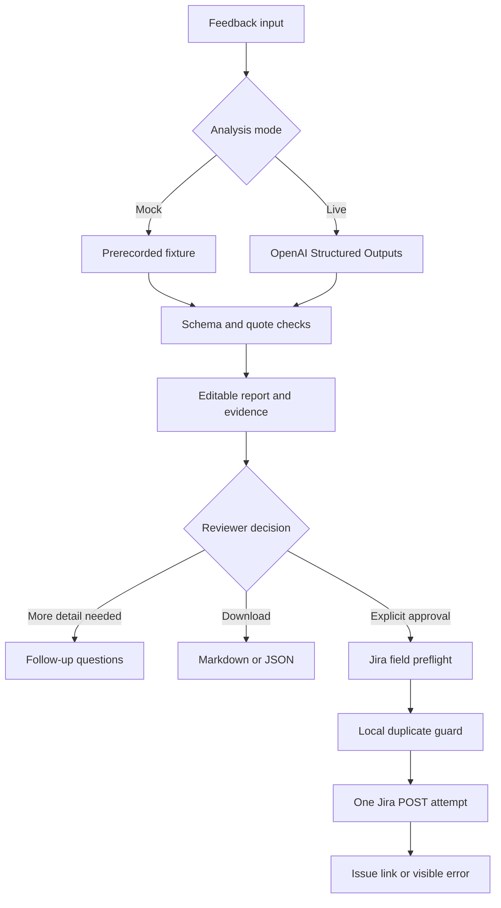

# Signal to Issue ↗

**Customer feedback → evidence-linked draft → human-reviewed Jira issue.**

[](https://www.python.org/)
[](LICENSE)
[](https://github.com/roger-rep/Automation/actions/workflows/ci.yml)

An approachable support automation built by **Nestor Rogel**. Paste a customer message, review a structured escalation, and export it or deliberately submit it to Jira. Try the entire drafting workflow locally with fictional examples and no credentials.

## Why this exists

Support agents repeatedly translate incomplete messages into reports engineers can investigate. Useful details get buried, missing information gets overlooked, and suspected bugs can become confident diagnoses too early.

Signal to Issue prepares that first draft while preserving the boundary between **what the customer said**, **what is still unknown**, and **what a reviewer decides to escalate**.

### A quick example

> “I blocked November 20–22 in the property calendar, but the connected calendar still shows those dates as available. I refreshed the page twice. Guests can still request those dates.”

| Report field | Draft output |
| --- | --- |
| Classification | Suspected bug; cause remains unconfirmed |
| Title | Blocked dates reportedly remain available in connected calendar |
| Reported behavior | The connected calendar still displays the blocked dates as available |
| Reported impact | Guests can still request the affected dates |
| Expected behavior | Not provided |
| Missing details | Channel, property, year/timezone, timestamps, synchronization interval |

Every extracted fact has a source quote. Quote checks establish that the text appeared in the input; a reviewer still needs to check the interpretation.

## Features

- Four tentative categories: suspected bug, possible configuration issue, feature request, or unclear.
- Structured facts, explicit unknowns, and follow-up questions.
- Editable report with a separate view of the original draft's evidence.
- Markdown and JSON downloads.
- Optional Jira Cloud integration with create-field metadata preflight and formatted ADF descriptions.
- Explicit approval before Jira creation; the model has no external-action tools.
- Durable local submission journal to block identical repeated requests and ambiguous retries.
- Five fictional fixtures, a CLI, automated UI checks, and GitHub Actions CI.

## Architecture



| Component | Purpose |
| --- | --- |
| Python + Streamlit | One-language local interface |
| OpenAI SDK + Pydantic | Structured extraction and typed validation |
| Requests | Small, inspectable Jira REST adapter |
| SQLite, from Python's standard library | Submission fingerprints, status, and issue keys |
| pytest + Ruff + GitHub Actions | Behavior checks, formatting, and CI |

## Run locally

**Prerequisites:** Python 3.11+ and Git. Mock mode requires no API key, Jira account, or paid service.

```bash
git clone https://github.com/roger-rep/Automation.git
cd Automation
python -m venv .venv
```

Activate your environment:

```powershell
# Windows PowerShell
.venv\Scripts\Activate.ps1
```

```bash
# macOS / Linux
source .venv/bin/activate
```

Install and launch:

```bash
python -m pip install -e .
python -m streamlit run app.py
```

Open the local address printed in the terminal, usually `http://localhost:8501`.

1. Leave **Mock demo** selected.
2. Select a fictional example and click **Replay mock analysis**.
3. Review the unknowns and source quotes; edit the report and click **Save reviewed report**.
4. Download the saved Markdown or JSON.

**Mock mode replays hand-authored outputs for the included examples. It does not run an offline AI model or analyze arbitrary text.** Editing the input requires Live AI, or selecting an unchanged fixture again.

See the [60-second demonstration script](docs/DEMO.md).

## Enable live AI analysis

Copy `.env.example` to `.env` in the repository root and set:

```dotenv
OPENAI_API_KEY=your_api_key_here
OPENAI_MODEL=gpt-4o-mini
```

Restart the app after changing configuration, choose **Live AI**, and click **Analyze with OpenAI**. You can select another model supported by your API account and Structured Outputs. Live calls require API access and incur provider usage charges.

The app sends the submitted feedback to OpenAI. It asks for a typed report, checks quoted text against the input, and refuses incomplete or invalid outputs. It requests `store=False`; this does not establish a blanket zero-retention guarantee. Review your provider's current data controls before using non-fictional information.

## Optional: create a Jira issue

Use a **personal demo project** for a portfolio demonstration. Set these values in your local `.env`:

```dotenv
JIRA_URL=https://your-team.atlassian.net
JIRA_EMAIL=your_account_email
JIRA_API_TOKEN=your_unscoped_api_token
JIRA_PROJECT_KEY=DEMO
JIRA_ISSUE_TYPE=Bug
```

This adapter supports Jira Cloud tenant URLs and email + **unscoped API token** authentication. Scoped-token gateway URLs and Jira Data Center are not implemented. The account needs permission to browse the project and create issues. Never use your account password as the token.

1. Generate and save a report.
2. Expand **Optional · Create a Jira issue** and verify the displayed destination.
3. Review whether your configured issue type suits the classification. Feature requests are not automatically converted into bugs.
4. Check the review approval box and click **Create Jira issue**.

The app fetches the project's available issue types and required fields, reserves a local submission fingerprint, and makes one creation attempt. Jira may notify project watchers. Simply analyzing feedback never creates an issue.

If your project requires extra fields, configure their exact Jira field IDs and correctly typed values:

```dotenv
JIRA_EXTRA_FIELDS={"customfield_10001":"Support"}
```

Field IDs, available values, and value shapes vary by project. Core report and destination fields cannot be overridden through this setting.

### Duplicate protection and uncertain submissions

An identical Jira payload for the same tenant is protected across app restarts by `.local/submissions.sqlite3`. A timeout, connection failure, server error, or accepted response without a valid issue key retains a reservation because the issue may already exist. The app never automatically retries a Jira POST.

Inspect local status:

```bash
python -m signal_to_issue submissions
```

If an outcome is uncertain, **check Jira first**. Only after confirming that no issue exists, release that uncertain reservation:

```bash
python -m signal_to_issue allow-retry YOUR_SUBMISSION_ID --checked-jira
```

Successful records cannot be released through this command. This is a local identical-payload guard, not semantic deduplication or a Jira-wide exactly-once guarantee. Changed reports or separate database files can still create similar issues. Share the same database when running multiple local instances.

## CLI

The CLI prepares drafts and performs evaluation; it never creates Jira issues.

```bash
python -m signal_to_issue analyze --example calendar
python -m signal_to_issue analyze --example configuration --output reports/draft.md
python -m signal_to_issue analyze --file feedback.txt --live --output reports/draft.md
```

CLI outputs remain drafts and require human review.

## Tests and evaluation

```bash
python -m pip install -e ".[dev]"
python -m pytest
ruff check .
ruff format --check .
python -m signal_to_issue evaluate
python -m build
```

The test suite covers source-quote rejection, explicit unknowns, schema errors, incomplete AI outputs, Jira field preflight, pagination, duplicate attempts, uncertain outcomes, secret-free error messages, and the actual Streamlit review flow. API boundaries are mocked in automated tests.

`evaluate` without `--live` validates fixture schemas and quotes. **Fixture success is not AI classification accuracy.** To evaluate the configured model on the five fictional examples:

```bash
python -m signal_to_issue evaluate --live
```

This sends five AI requests and reports per-case schema/quote validity and agreement with reference classifications. These five examples are a smoke check, not a representative benchmark or a prompt-injection security guarantee. No live accuracy or time-savings claim is made here.

## Project map

```text
app.py                       Streamlit input, review, export, and approval UI
signal_to_issue/
  models.py                  Typed drafts, reviewer edits, quote checks
  analyzer.py                Mock fixtures and live OpenAI adapter
  config.py                  Environment configuration and destination checks
  render.py                  Markdown and Atlassian Document Format
  jira.py                    Metadata preflight and approved issue creation
  journal.py                 Durable submission reservations
  cli.py                     Drafts, evaluation, and retry recovery
  data/examples.json         Fictional cases and prerecorded outputs
tests/                       Unit, integration-boundary, and Streamlit UI tests
docs/DEMO.md                 Short portfolio walkthrough
```

## Data handling and limitations

- The app does not read your inbox or access your employer's systems automatically.
- Feedback and editable drafts live in the local Streamlit session. Markdown/JSON downloads contain report content; handle them accordingly.
- Live analysis sends feedback to OpenAI. Approved Jira submission sends the saved report and configured extra fields to the configured Jira tenant.
- The submission database stores payload hashes, status, issue keys, and timestamps; it does not store feedback, API tokens, or email addresses.
- No external-action tools are exposed to the model. Untrusted feedback is isolated as data, but prompting and quote validation do not guarantee immunity to malicious input or hallucination.
- Schema checks establish structure. Quote checks establish text presence. Neither proves a bug, root cause, correct classification, or accurate interpretation.
- Keep credentials in your local `.env`; `.env`, local state, reports, and Streamlit secrets are ignored by Git.
- This is a local, single-reviewer portfolio application. Authentication, tenant isolation, retention controls, and deployment hardening would be needed for a shared production service.

## Roadmap

- Import multiple feedback messages with per-report review.
- Add support-platform webhook input.
- Expand labeled evaluations with independently reviewed cases.

## Contributing and license

See [CONTRIBUTING.md](CONTRIBUTING.md) for development instructions and [SECURITY.md](SECURITY.md) for reporting vulnerabilities. Released under the [MIT License](LICENSE).

## References

- [OpenAI Structured Outputs](https://developers.openai.com/api/docs/guides/structured-outputs)
- [Jira Cloud issue creation and metadata](https://developer.atlassian.com/cloud/jira/platform/rest/v3/api-group-issues/)
- [Jira basic authentication](https://developer.atlassian.com/cloud/jira/platform/basic-auth-for-rest-apis/)
- [Streamlit local setup](https://docs.streamlit.io/get-started/installation/command-line)
- [Pydantic models](https://pydantic.dev/docs/validation/latest/concepts/models/)
